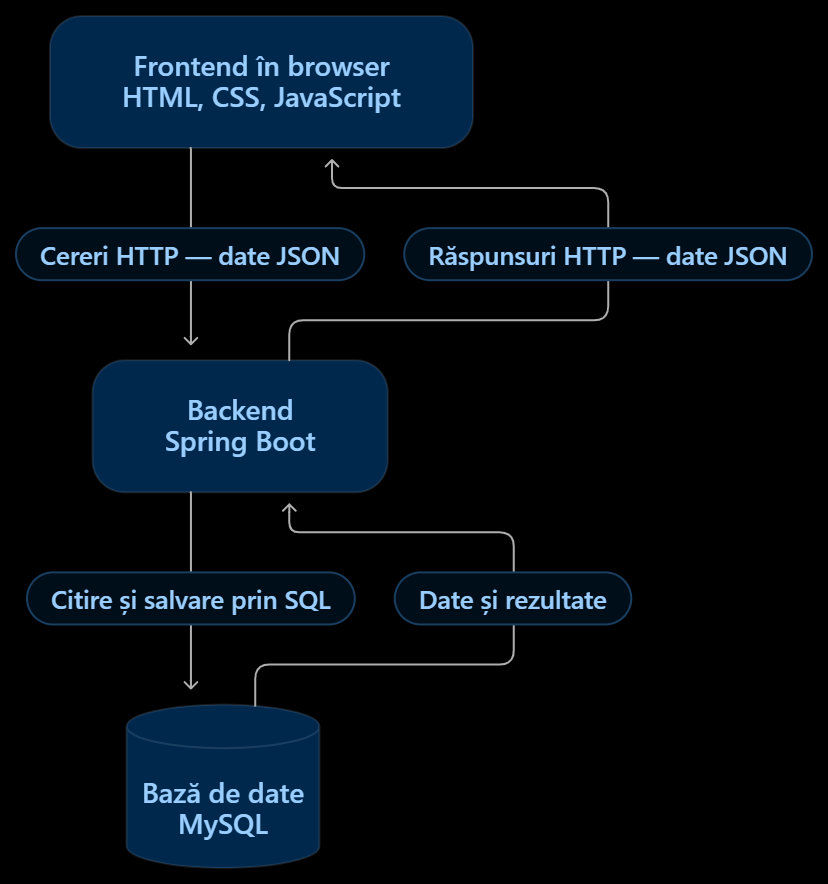

# Arhitectura aplicației

## Diagrama de arhitectură

Diagrama de mai jos prezintă componentele principale ale aplicației și comunicarea dintre acestea.

## Componentele aplicației

### Frontend

- **HTML și CSS** — Pentru structura și aspectul paginilor aplicației.
- **SvelteKit** — Pentru organizarea paginilor, navigarea între acestea și reutilizarea componentelor interfeței.
- **JavaScript** — Pentru interacțiunea cu utilizatorul și comunicarea cu backendul.

### Backend

- **Java și Spring Boot** — Pentru autentificare, gestionarea exercițiilor, calcularea punctajelor și salvarea datelor.

### Baza de date

- **PostgreSQL găzduit pe Supabase** — Pentru stocarea datelor în tabele și gestionarea relațiilor dintre utilizatori, quiz-uri, rezultate și planuri de studiu.

## Fluxul de navigare și comunicarea dintre componente

Elevul introduce emailul și parola și apasă butonul „Conectare”. După autentificare, se deschide pagina principală, unde sunt afișate capitolele de informatică și meniul cu opțiunile „Plan de studiu” și „Progres”.

La selectarea unui capitol, elevul accesează lista exercițiilor și a quiz-urilor disponibile. Dacă alege un exercițiu, se deschide pagina cu enunțul și zona pentru introducerea răspunsului. După apăsarea butonului „Verifică”, este afișat feedbackul.

Dacă alege un quiz, se deschide pagina cu întrebările acestuia. După completarea răspunsurilor și apăsarea butonului „Trimite”, elevul este direcționat către pagina cu punctajul obținut și explicațiile pentru răspunsurile greșite.

Din meniu, elevul poate accesa pagina „Plan de studiu”, unde poate adăuga activități, stabili termene-limită și marca activitățile finalizate. În pagina „Progres”, poate consulta quiz-urile rezolvate, datele și punctajele obținute. Elevul poate reveni la pagina principală prin meniul aplicației.

După autentificare, administratorul accesează pagina de administrare. De aici, poate deschide listele de exerciții, quiz-uri și utilizatori înregistrați. Acesta poate adăuga, modifica sau șterge exerciții și quiz-uri și poate gestiona conturile utilizatorilor.
