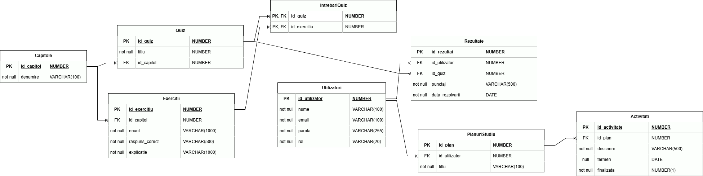

## Diagrama modelului de date

Diagrama de mai jos prezintă modelul preliminar al bazei de date, entitățile și relațiile dintre acestea.

## Endpoint-uri principale

| Acțiune | Endpoint propus | Ce face |
|---|---|---|
| Afișarea capitolelor | `GET /capitole` | Returnează capitolele de informatică |
| Afișarea exercițiilor unui capitol | `GET /capitole/{id}/exercitii` | Returnează exercițiile capitolului ales |
| Deschiderea unui quiz | `GET /quizuri/{id}` | Returnează întrebările quiz-ului |
| Trimiterea răspunsurilor | `POST /quizuri/{id}/rezultate` | Primește răspunsurile, salvează rezultatul și returnează punctajul și feedbackul |
| Consultarea progresului | `GET /progres` | Returnează rezultatele elevului autentificat |
| Crearea unui plan | `POST /planuri` | Salvează un plan de studiu |
| Adăugarea unei activități | `POST /planuri/{id}/activitati` | Adaugă o activitate în plan |
| Finalizarea unei activități | `PATCH /activitati/{id}` | Actualizează starea activității |****
